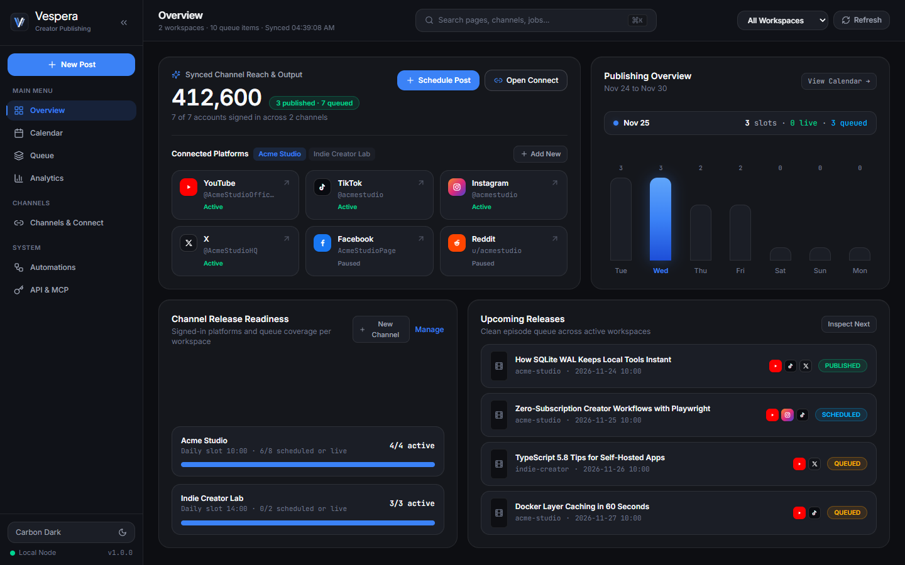

<p align="left">
  
</p>

# Vespera

[](https://github.com/JhinxDev/vespera/actions/workflows/ci.yml)
[](https://github.com/JhinxDev/vespera/releases/latest)
[](https://github.com/JhinxDev/vespera/pkgs/container/vespera)
[](LICENSE)
[](https://nodejs.org/)

Self-hosted, zero-subscription social media publishing workbench, direct video uploader, OAuth2 + portable browser session manager, automation engine, and AI/MCP creator analytics studio.

Built with Node.js 24 (`node:sqlite`), Playwright Chromium/Edge contexts, React 19, Tailwind CSS v4, a REST + HMAC-SHA256 Webhook API, and an MCP stdio server (`vespera_*`).



## Why Vespera

- **$0/month Self-Hosted:** Runs locally or in a lightweight Docker container (`node:24-bookworm-slim` + SQLite), keeping all media, job history, and sessions on your own hardware.
- **Carbon Bento Workspace:** Structured dark/light bento UI with 7-day publishing cadence bars, grouped episode cards across Week Agenda & Month Grid calendars, 9:16 portrait thumbnails, and an inline `<video>` inspector drawer.
- **Direct Browser Media Uploads:** Stream `.mp4`, `.mov`, `.webm`, and cover images up to `512 MB` straight from the **New Post** modal (`POST /api/media/upload`) with automatic SHA-256 integrity checks.
- **On-Demand Live Browser, Session Sync & Optional OAuth2:** Launch an isolated container browser via embedded noVNC (`Xvfb` + `openbox` + `x11vnc` + `websockify`, idle-off with 15-minute auto-stop) to resolve 2FA or verification prompts directly in the persistent server profile, push local Edge `storageState` cookies (`npm run sync-sessions`), or configure free official OAuth2 (`youtube` / `reddit`).
- **Full YouTube & Multi-Platform Uploader:** Populates YouTube titles, descriptions, tags, video language, and category in full Chrome on ephemeral Xvfb with native UA alongside support for **TikTok, Instagram, X, Facebook, Reddit, and Threads**, 11 built-in presets (**LinkedIn, Bluesky, Pinterest, Discord, Telegram, Slack, Mastodon, Twitch, Medium, Dev.to, WordPress**), and a UI **Custom Platform Builder**.
- **Guarded Auto-Post Scheduler:** Paused by default (`Auto-Post: Paused`) until toggled ON in the Queue view (`POST /api/scheduler`), with one-click `Dry-Run Due` validation before live publishing.

## Quick Start (Docker)

Pull and run the prebuilt GHCR image (`ghcr.io/jhinxdev/vespera:latest`):

```bash
git clone https://github.com/JhinxDev/vespera.git
cd vespera
cp .env.example .env
cp channels.example.json channels.local.json
docker compose up -d
```

To build from local source instead, run `docker compose build && docker compose up -d` (after uncommenting `build: .` in `docker-compose.yml`).

Open `http://127.0.0.1:4660` (data persists in the `vespera_data` `/data` volume).

## Quick Start (Local Development)

Requires **Node.js >= 24.0.0** (`node:sqlite` built-in).

```bash
git clone https://github.com/JhinxDev/vespera.git
cd vespera
npm ci
cp .env.example .env
cp channels.example.json channels.local.json
npm run build:server
npm run build:web
npm start
```

- Dashboard: `http://127.0.0.1:4660`
- Compact Connect View: `http://127.0.0.1:4660/connect`
- Health Check: `GET http://127.0.0.1:4660/api/health`

## Connecting Platforms (Live Browser, Session Sync & OAuth2)

When hosting Vespera in a headless Docker container, you have three authentication paths:

1. **On-Demand Live Browser (noVNC):** Click **Live Browser** from the Channels or Connect view to start an isolated `Xvfb` + `openbox` + `x11vnc` + `websockify` session (`POST /api/live-browser/start`) inside the embedded `/live-browser/` viewer. It stays idle-off until launched, auto-stops after 15 minutes, and flushes cookies cleanly to the container's persistent browser profile on stop so you can complete Google `"Verify it's you"`, 2FA, or passkey prompts directly on the server.
2. **Native Edge Session Sync (`npm run sync-sessions`):** Opens a clean, extension-free native Windows Edge profile so you sign in locally, then streams the resulting `storageState` cookies directly to your Vespera server:
   ```bash
   # Sign in interactively for one channel + platform and verify immediately
   npm run sync-sessions -- acme-studio tiktok --remote https://vespera.example.com

   # Export existing local Vespera Edge profiles to your remote server headlessly
   npm run sync-sessions -- --export-only --all --remote https://vespera.example.com
   ```
3. **Official YouTube & Reddit OAuth2:** Populate `YOUTUBE_CLIENT_ID` / `YOUTUBE_CLIENT_SECRET` or `REDDIT_CLIENT_ID` / `REDDIT_CLIENT_SECRET` in `.env` so clicking **Connect** redirects straight through `/api/oauth/:platform/start` and stores auto-refreshing tokens in SQLite (`oauth_tokens`).

## Environment Variables

| Variable | Default | Purpose |
| --- | --- | --- |
| `VESPERA_HOST` | `127.0.0.1` (`0.0.0.0` in Docker) | HTTP bind address |
| `VESPERA_PORT` | `4660` | HTTP server port |
| `VESPERA_DATA_DIR` | OS app data (`%LOCALAPPDATA%\Vespera` / `~/.local/share/vespera`, `/data` in Docker) | SQLite DB, uploaded media, profiles, and evidence screenshots |
| `VESPERA_CHANNELS_FILE` | `./channels.local.json` | Initial workspace & connection seed JSON |
| `VESPERA_PUBLIC_BASE_URL` | Request host headers | Public base URL used for OAuth2 callback redirects |
| `YOUTUBE_CLIENT_ID` / `YOUTUBE_CLIENT_SECRET` | Unset | Enables built-in Google/YouTube OAuth2 |
| `REDDIT_CLIENT_ID` / `REDDIT_CLIENT_SECRET` | Unset | Enables built-in Reddit OAuth2 & API posting |

## CLI & Automation Commands

```bash
npm run dev                        # Start local TypeScript server
npm run dev:web                    # Start Vite frontend dev server
npm run typecheck                  # Typecheck server + React frontend
npm test                           # Run unit, HTTP/MCP, and hygiene tests
npm run sync-sessions -- <id> <p>  # Sign in with local Edge and push session to remote server
npm run connect -- <id> [platform] # Open isolated local Edge connect window (desktop mode)
npm run check -- [id] [platform]   # Verify live session status and save screenshots
npm run sync-analytics -- [id]     # Collect channel & per-video analytics into SQLite
npm run worker -- --dry-run        # Validate due jobs without posting
npm run worker -- --limit 4        # Execute due jobs up to limit
npm run mcp                        # Start stdio MCP server for AI agents
```

## API & MCP Highlights

- **Scheduler:** `GET /api/scheduler` and `POST /api/scheduler` (`{ enabled, runNow, dryRun }`)
- **Direct Media Upload:** `POST /api/media/upload?kind=video|cover&filename=<name>`
- **Live Browser (noVNC):** `GET /api/live-browser`, `POST /api/live-browser/start`, `POST /api/live-browser/stop`, and `/live-browser/`
- **Session State Sync:** `POST /api/channels/:id/session-state` (requires Bearer API token)
- **OAuth2:** `GET /api/oauth/config`, `GET /api/oauth/:platform/start?channelId=<id>`
- **Webhooks & API Keys:** Outbound HMAC-SHA256 headers (`X-Vespera-Event`, `X-Vespera-Signature`) and scoped `vsp_live_*` Bearer keys
- **MCP Server:** Exposes `vespera_*` status, job creation, dry-run/execution, analytics sync, and video intelligence tools over stdio (`npm run mcp`)

## Configuration & Data Safety

Personal channel rosters, cookies, `.env`, local deployment targets (`.deploy.local.json`), uploaded videos, API tokens (`api-token.txt`), and SQLite databases (`vespera.sqlite`) stay strictly outside Git. Running `npm test` enforces that zero `.env`, `*.local.json`, `*.sqlite*`, private LAN IPs, leaked tokens, or local user paths are tracked.

## Contributing & Security

- Read [CONTRIBUTING.md](CONTRIBUTING.md) for local test/build steps before opening a pull request.
- Read [SECURITY.md](SECURITY.md) for private vulnerability reporting and deployment hardening notes.

## License

[MIT](LICENSE)
